> **Historical document.** Written for the working name Golden Repo; the project is now SWERepo (ADR-20261120-1a27). Not maintained: SWEREPO-SPEC.md is the source of truth, and its Appendix B records what was taken from this design.

# Golden Repo: Architecture & Implementation Blueprint

## 1. The Core Thesis: Two-Loop AI Engineering Governance

Most "starter templates" fail within weeks because they treat specs as static Markdown, leave AI instructions advisory, and lose GitHub repository settings on `git clone` or "Use this template".

**Golden Repo** solves this by pairing **forward-looking spec design** with **backward-ratcheting invariant locks**, backed by deterministic local gates and GitHub Rulesets-as-Code:

1. **Forward Loop — Intent Before Code (`OpenSpec`)**: Changes start as explicit proposals and spec deltas in `openspec/changes/` (`Explore → Propose → Review → Apply → Archive`) before implementation begins.
2. **Backward Loop — Earned Contracts After Code Works (`SeamSpec`)**: Once a critical behavior works—or a user states an invariant or hits a failed approach—`SeamSpec` captures it as a hash-locked behavioral test, file-scoped decision, or dead end in `.seamspec/`, enforced at **Agent Stop**, **`git pre-commit` (staged tree)**, and **CI**.
3. **Institutional Memory (`docs/adr/` + `docs/PROGRESS.md`)**: Architectural, schema, dependency, and workflow changes require an immutable ADR (`ADR-YYYYMMDD-xxxx-slug.md`), and every deliverable PR updates `docs/PROGRESS.md` in the same branch.
4. **Merge Gate (`GitHub Ruleset` + `@copilot` + `ci-ok`)**: Automated Copilot PR reviews open conversation threads that **block merging** until resolved or answered, paired with a single immutable `ci-ok` status check.

```mermaid
flowchart LR
    subgraph Plan["1. Intent (OpenSpec)"]
        OS_Prop["openspec/changes/<br/>Proposal + Tasks + Delta"]
        OS_Rev["Human Spec Review"]
        OS_Prop --> OS_Rev
    end

    subgraph Build["2. Build & Lock (Agent + SeamSpec)"]
        Prog["Read docs/PROGRESS.md<br/>+ seamspec context"]
        Code["Implement + Update<br/>ADR & PROGRESS.md"]
        SS_Lock["Propose SeamSpec Rules<br/>+ Log Dead Ends"]
        StopHook["Editor Stop Hook:<br/>seamspec + golden check"]
        Prog --> Code --> SS_Lock --> StopHook
    end

    subgraph LocalGate["3. Local Git Gate"]
        PreCommit["pre-commit:<br/>gitleaks + lint + golden check<br/>+ seamspec verify --gate"]
        HumanLock["Human runs:<br/>seamspec review"]
        HumanLock --> PreCommit
    end

    subgraph PRGate["4. GitHub PR & CI Gate"]
        Copilot["Auto @copilot Review<br/>(Threads Block Merge)"]
        CIOk["Hardened CI -> ci-ok<br/>(Tests + SeamSpec + Governance)"]
        Archive["openspec archive +<br/>Squash Merge to main"]
        Copilot --> Archive
        CIOk --> Archive
    end

    OS_Rev --> Prog
    StopHook --> HumanLock
    PreCommit --> Copilot
    PreCommit --> CIOk
```



---

## 2. Best Delivery Form Factor: CLI Scaffolder + Governance Doctor + Showcase Repo

> [!IMPORTANT]
> GitHub's "Use this template" button **only copies files**—it drops Branch Rulesets, Copilot auto-review rules, squash-merge settings, and local git hooks. And static templates cannot upgrade existing repositories when your standards evolve.

Implement **`golden-repo`** as a **model-free Python/`uv` CLI + Copier template** (mirroring `SeamSpec`'s zero-LLM-dependency design, see SeamSpec's `CLAUDE.md`), paired with a live public showcase repository:

| Component | Command | What It Does |
| :--- | :--- | :--- |
| **Scaffolder & Upgrader** | `golden init --stack <python-uv \| ts-vitest \| polyglot>` | Renders stack files via Copier (supports non-destructive `golden upgrade` later), initializes `openspec/`, runs `seamspec init --ci --hosts cursor,vscode,antigravity`, installs `.githooks/`, and generates synced `AGENTS.md` + `CLAUDE.md`. |
| **GitHub Provisioner** | `golden github-setup` | Idempotently applies `.github/governance/repo-settings.json` (squash-only, auto-delete head branches) and `.github/governance/ruleset-main.json` (Copilot auto-review, conversation resolution, `ci-ok` gate) via `gh api`. |
| **Deterministic Checker** | `golden check [--staged \| --pr \| --doctor]` | Verifies `AGENTS.md`/`CLAUDE.md` preamble parity, ADR frontmatter & `docs/adr/README.md` index sync, `docs/PROGRESS.md` updates on PRs, dependency-ADR rules, and OpenSpec validity. |
| **Showcase Repo** | `golden-repo` (dogfooded) | Public reference repo with real `openspec/` specs, locked `.seamspec/` rules, ADRs, Copilot review history, and green `ci-ok` runs. |

---

## 3. Initialized Repository Layout

```text
<project-root>/
├── AGENTS.md                          # Unified instructions for Cursor, VS Code, Antigravity (+ seamspec agents block)
├── CLAUDE.md                          # Unified instructions for Claude Code (+ seamspec claude block)
├── BRAINDUMP.md                       # Git-ignored scratchpad drained via SeamSpec (/seamspec:drain)
├── justfile                           # Uniform agent/human entrypoints: setup, check, test, spec, pr
├── openspec/
│   ├── specs/                         # Permanent, living capability specifications
│   └── changes/                       # Active feature proposals, task checklists & spec deltas
├── .seamspec/                         # Hash-locked behavioral rule tests, file-scoped ADRs & dead ends
├── docs/
│   ├── PROGRESS.md                    # Single source of truth for Done / In Progress / Next
│   ├── EARNED_SPEC.md                 # Deterministic output of `seamspec spec` (verified in CI)
│   ├── ARCHITECTURE.md                # High-level module boundaries & layer rules
│   └── adr/
│       ├── README.md                  # Trigger table, naming rules & auto-verified ADR index
│       └── ADR-YYYYMMDD-xxxx-init.md  # Immutable decision records
├── .github/
│   ├── copilot-instructions.md        # Tuned specifically for GitHub Copilot PR Code Review
│   ├── CODEOWNERS                     # Protects .seamspec/, openspec/specs/, .github/, AGENTS.md, CLAUDE.md
│   ├── pull_request_template.md       # Spec, SeamSpec, ADR, PROGRESS.md & Copilot disposition checklist
│   ├── governance/
│   │   ├── repo-settings.json         # Squash-merge, auto-delete branch, auto-merge config
│   │   └── ruleset-main.json          # Declarative GitHub Branch Ruleset for `main`
│   └── workflows/
│       ├── ci.yml                     # Governance + SeamSpec + Lint/Types + Matrix Tests + Security -> ci-ok
│       └── release.yml                # Tag-verified OIDC trusted publishing + SLSA provenance
├── .agents/                           # Antigravity: hooks.json (PreToolUse + Stop), skills/, reviewer agent
├── .cursor/                           # Cursor: hooks.json, mcp.json, commands/, reviewer agent
├── .vscode/                           # VS Code: mcp.json (paired with .github/hooks/ & .github/prompts/)
├── .claude/                           # Claude Code: settings.json (project-scoped seamspec plugin + hooks)
└── .githooks/                         # Versioned hooks: pre-commit, commit-msg, pre-push
```

---

## 4. Multi-Editor Agent Architecture (`AGENTS.md`, `CLAUDE.md`, Copilot)

### Solving the Multi-Host Synchronization Problem Cleanly
In SeamSpec's `seamspec/installers/directive.py`, `seamspec init` writes a `claude` block (`/seamspec:*`) into `CLAUDE.md` and an `agents` block (`/seamspec-*`) into `AGENTS.md`, leaving everything **above** `<!-- seamspec:begin` untouched. Meanwhile, Cursor and VS Code read `AGENTS.md` directly without expanding Claude's `@file` imports, and Antigravity enforces a `24 KB` per-file cap (Antigravity's rules documentation).

> [!TIP]
> **Best Pattern**: Keep a concise (~100-line) **Golden Engineering Preamble** directly above `<!-- seamspec:begin` in both `AGENTS.md` and `CLAUDE.md`. `golden sync` writes both from one template, and `golden check` fails pre-commit/CI if the preambles ever drift—giving every editor zero-indirection instructions while preserving each host's native `SeamSpec` block.

### What the Shared Preamble Enforces (`AGENTS.md` & `CLAUDE.md`)

```markdown
# Working in <Project Name>

## 1. Start Every Session Here
1. Read `docs/PROGRESS.md` first (what is done, in flight, and next).
2. Check active proposals in `openspec/changes/` and run `seamspec status` (or read session-start summary).
3. Before touching any file, call `get_constraints(files)` (or `seamspec context <files>`) and check `docs/adr/README.md`.

## 2. Two-Loop Spec & Invariant Workflow
- **Non-trivial features/changes start in OpenSpec**: draft or update `openspec/changes/<slug>/` (`proposal.md`, `tasks.md`, spec delta) and get human agreement before writing production code.
- **Lock working agreements in SeamSpec**: when a user states a rule, a contract starts working, or an approach fails, capture it via `propose_invariant`, `propose_decision`, or `log_dead_end`. Run `seamspec verify --proposed <id>` and lint the test file before asking the human to run `seamspec review`.
- **Keep earned spec current**: run `seamspec spec --out docs/EARNED_SPEC.md` whenever approved rules change.

## 3. Mandatory ADRs & Progress Tracking
- **Update `docs/PROGRESS.md` in every deliverable PR** (move completed items to `Done` with date, PR branch, and ADR/invariant IDs; update `In Progress` and `Next`).
- **Write an ADR (`docs/adr/ADR-YYYYMMDD-xxxx-slug.md`) and update `docs/adr/README.md` in the same commit** whenever a change:
  1. Alters or adds to `openspec/specs/`, public APIs, CLI flags, schemas, or config defaults.
  2. Adds or replaces a runtime/build dependency in `pyproject.toml` / `package.json`.
  3. Crosses or modifies module boundaries in `docs/ARCHITECTURE.md`.
  4. Changes CI workflows, git hooks, or build/review governance.
  *(Pure internal refactors, tests, and bug fixes matching existing specs do NOT get an ADR.)*
- Never delete an ADR; supersede old ones by setting `status: SUPERSEDED` + `superseded_by:`.

## 4. Branches, Pull Requests & Copilot Review Loop
- **Never commit or push directly to `main`**. Use `feat/<topic>`, `fix/<topic>`, `docs/<topic>`, `chore/<topic>`.
- Fill out `.github/pull_request_template.md` completely.
- **Copilot Code Review is mandatory**: if the ruleset hasn't auto-requested `@copilot`, run `gh pr edit <n> --add-reviewer @copilot`.
- Before asking a human to merge, inspect all review threads (`just pr-threads <n>`):
  - For valid issues: fix on the branch, push, and reply in the thread citing the fix commit.
  - For false positives / intentional trade-offs: reply in the thread with concrete rationale.
  - Summarize thread dispositions in the PR comment.

## 5. Commands
- `just setup`   # install dependencies, hooks, seamspec & openspec
- `just check`   # lint, format check, typecheck, arch boundaries, golden check, seamspec verify
- `just test`    # full unit + integration test suite

<!-- seamspec:begin (managed by `seamspec init`; edit outside these markers) -->
...
<!-- seamspec:end -->
```

### Tuning `.github/copilot-instructions.md` for Signal-Only PR Threads
Because `required_review_thread_resolution: true` turns **every** Copilot review comment into a merge blocker, `.github/copilot-instructions.md` must suppress low-value noise:
- **Do NOT comment on**: formatting, import sorting, or style covered by Ruff/Biome/Prettier.
- **DO comment on**:
  1. Drift between PR code changes and `openspec/changes/` or `openspec/specs/`.
  2. Public contract, schema, or dependency changes missing an `ADR-*.md` update or `docs/PROGRESS.md` entry.
  3. Behavioral guarantees introduced without a corresponding `SeamSpec` invariant or unit test.
  4. Concurrency hazards, auth/trust boundary bugs, shell/SQL injection, and unhandled error paths.

---

## 5. Multi-Layer Enforcement: Hooks, GitHub Rulesets & CI

### Layer A: Editor Lifecycle Hooks (`.agents/hooks.json`, `.cursor/hooks.json`, `.claude/`)
Beyond SeamSpec's `SessionStart` and `Stop` hooks:
- **`PreToolUse` Guardrail** (supported natively in Claude Code and Antigravity's `.agents/hooks.json`, per Antigravity's hooks documentation):
  - Hard-denies (`"decision": "deny"`) `git commit --no-verify`, `git push ... main`, direct edits to `.seamspec/` outside SeamSpec CLI/MCP, and `uv publish` / `npm publish` without explicit user confirmation.
- **Cross-Editor Workflow Skills** (`/new-feature`, `/record-adr`, `/prepare-pr`, `/address-review`) packaged identically across `.agents/skills/`, `.cursor/commands/`, `.github/prompts/`, and `.claude/skills/`.

### Layer B: Fast Local Git Hooks (`.githooks/` + `prek`)
1. **`pre-commit`**:
   - `gitleaks git --staged --no-banner` (blocks secrets before they ever enter a commit SHA).
   - Fast staged-file lint & format check (explicitly excluding `.seamspec/` per SeamSpec's `ADR-20261013-c3f7` (approved rule tests are not linted) so hash-locked rule tests stay untouched).
   - `golden check --staged` (blocks commits on `main`, checks ADR index & `AGENTS.md`/`CLAUDE.md` sync).
   - `seamspec verify --gate` (runs locked invariants against the staged git index).
2. **`commit-msg`**: Enforces Conventional Commits (`feat:`, `fix:`, `docs:`, `refactor:`, `test:`, `chore:`).
3. **`pre-push`**: Runs static typecheck (`pyright`/`ty` or `tsc --noEmit`) before pushing.

### Layer C: GitHub Ruleset-as-Code (`.github/governance/ruleset-main.json`)
Applied automatically via `golden github-setup` using `gh api /repos/{owner}/{repo}/rulesets`:

```json
{
  "name": "golden-main-protection",
  "target": "branch",
  "enforcement": "active",
  "conditions": {
    "ref_name": {
      "include": ["~DEFAULT_BRANCH"],
      "exclude": []
    }
  },
  "rules": [
    { "type": "deletion" },
    { "type": "non_fast_forward" },
    { "type": "required_linear_history" },
    {
      "type": "pull_request",
      "parameters": {
        "required_approving_review_count": 1,
        "dismiss_stale_reviews_on_push": true,
        "require_code_owner_review": true,
        "require_last_push_approval": false,
        "required_review_thread_resolution": true
      }
    },
    {
      "type": "copilot_code_review",
      "parameters": {
        "review_on_push": true,
        "review_draft_pull_requests": false
      }
    },
    {
      "type": "required_status_checks",
      "parameters": {
        "strict_required_status_checks_policy": true,
        "required_status_checks": [
          { "context": "ci-ok" }
        ]
      }
    }
  ]
}
```

> [!NOTE]
> For solo developer repos where GitHub blocks self-approving your own PR, `golden github-setup --mode solo` sets `required_approving_review_count: 0` while keeping `required_review_thread_resolution: true`, `copilot_code_review`, and `ci-ok` strictly enforced!

### Layer D: Hardened 6-Job CI Pipeline Feeding `ci-ok`
Adapting the single-gate `ci-ok` pattern from SeamSpec's `.github/workflows/tests.yml`:
- Top-level `permissions: contents: read`, `persist-credentials: false`, concurrency cancel-in-progress on PRs, and **SHA-pinned Actions**.
1. **`governance`**: Runs `golden check --pr` (verifies `docs/PROGRESS.md` updated unless PR carries `trivial` label, ADR index & required triggers satisfied, `AGENTS.md`/`CLAUDE.md` synced, `openspec` change files valid).
2. **`seamspec`**: `fetch-depth: 0` → `seamspec doctor --ci` → `seamspec verify --all --ci` → `seamspec spec --check docs/EARNED_SPEC.md`.
3. **`quality-and-architecture`**: Formatter check, linter, strict typecheck, and **architectural boundary check** (`import-linter` / `dependency-cruiser`).
4. **`tests`**: Linux version matrix + `macos-latest` smoke/full run + **diff-coverage gate** (`≥ 85%` coverage on modified lines).
5. **`security`**: `zizmor` (static security audit of `.github/workflows/*.yml`), `gitleaks`, `dependency-review-action`, and `uv audit` / `npm audit`.
6. **`ci-ok`**: `if: always()` aggregator job requiring all 5 upstream jobs to equal `success`.

---

## 6. High-Leverage Additions (Item 6 Recommendations)

To make Golden Repo a genuine industry benchmark for AI-assisted software engineering, include these six "anti-slop" capabilities:

1. **Architectural Layer Contracts (`import-linter` / `dependency-cruiser`)**:
   AI agents frequently solve tasks by importing across layer boundaries (e.g., `core` importing `cli` or `db` leaking into `domain`). Baking in a 15-line layer contract file from Day 1 stops spaghetti architecture mechanically in CI.
2. **Dependency Budget Gate**:
   Agents love `uv add` / `npm install` for 10-line problems. `golden check --pr` detects diffs to `[project.dependencies]` in `pyproject.toml` or `dependencies` in `package.json` and requires an ADR in the same PR justifying why stdlib or existing packages weren't used.
3. **Committed `docs/EARNED_SPEC.md` (`seamspec spec --check`)**:
   Pair forward-looking `openspec/specs/` (what we *planned* to build) with `docs/EARNED_SPEC.md` generated from `.seamspec/` (what the code *provably guarantees today*). Reviewers can see contract changes directly in PR diffs.
4. **Tamper-Proof Governance via `CODEOWNERS`**:
   Lock `/.seamspec/`, `/openspec/specs/`, `/.github/`, `/AGENTS.md`, `/CLAUDE.md`, and `/docs/adr/` to human `@owners` in `.github/CODEOWNERS` so autonomous background agents can *propose* rule/CI updates but can never merge weakened guardrails without explicit human sign-off.
5. **Agent PR Thread Helper (`just pr-threads`)**:
   GitHub's standard `gh pr view` doesn't cleanly list unresolved inline review thread IDs and line context. Ship a 30-line `gh api graphql` recipe in `justfile` (`just pr-threads <pr>`) that prints unresolved Copilot/human review threads in compact Markdown so Claude Code, Antigravity, Cursor, and VS Code can read and reply to every thread accurately.
6. **Zero-Secret OIDC Release + SLSA Provenance**:
   Pre-wire `.github/workflows/release.yml` with tag-version/changelog verification (matching SeamSpec's `ADR-20261027-b1a4`, release workflow), PyPI/npm OIDC Trusted Publishing, and GitHub's `actions/attest-build-provenance`.

---

## 7. Suggested Implementation Phases

1. **Phase 1 — Core `golden-repo` CLI & Governance Checker**: Build `golden check` (`--staged`, `--pr`, `--doctor`), `golden sync` (`AGENTS.md` ↔ `CLAUDE.md` preamble sync), and `golden github-setup` (Ruleset + Repo settings via `gh api`).
2. **Phase 2 — Copier Stack Templates & Hook Wiring**: Create the `python-uv` and `ts-vitest` templates pre-wired with `OpenSpec`, `SeamSpec`, `.githooks/`, `justfile`, `.agents/` / `.cursor/` / `.vscode/` / `.claude/` skills & `PreToolUse` guards, and the 6-job `ci.yml` (`ci-ok`).
3. **Phase 3 — Dogfood & End-to-End Rehearsal**: Initialize a fresh repo with `golden init`, apply `golden github-setup`, run a real feature through `OpenSpec → Code + ADR + PROGRESS.md → SeamSpec Lock → PR + @copilot Thread Resolution → Squash Merge`, and lock Golden Repo's own invariants with `SeamSpec`.
